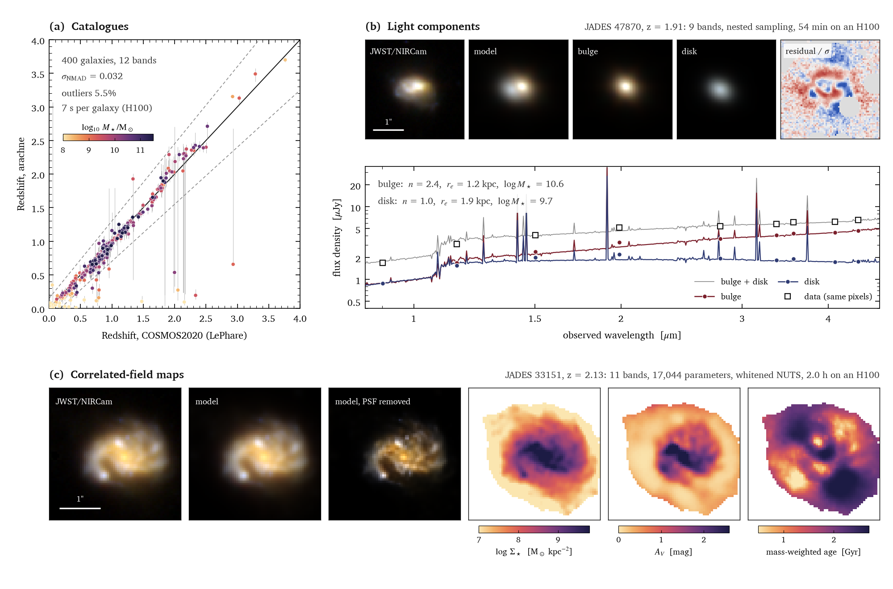

# arachne

**JAX-native SED fitting and image-level forward modelling of galaxies.**

arachne trains fast neural emulators of stellar-population-synthesis (SPS) photometry and uses
them for GPU-accelerated Bayesian inference: one integrated SED, a catalogue of thousands of
galaxies, or a spatially resolved multi-band image with PSF convolution. The pipeline is pure
JAX/Equinox, so it is differentiable end to end, JIT-compiled, and needs no PyTorch.



*(a) Photometric redshifts of 400 COSMOS2020 galaxies from 12-band photometry, against the
survey's LePhare values. (b) A JWST/NIRCam galaxy from JADES fitted as two Sérsic components,
each with its own SED: points are the fitted photometry, lines the spectra of the same
posterior from the full SPS model (`arachne.postprocess`). (c) Maps of stellar mass, dust and
age for a JADES spiral at z = 2.1, fitted with correlated-field priors. Made by
[docs/figures/make_frontpage.py](docs/figures/make_frontpage.py).*

Status: alpha (v0.1.0), under active development. Example command-line flags change; check
`--help`.

## What it does

| Problem | Model | Sampler |
|---|---|---|
| Integrated photometry, one galaxy or a catalogue | emulator SED | GPU-batched Pathfinder + NUTS, or nested slice sampling (NSS) for multimodal posteriors and evidence |
| A galaxy as a few light components (bulge, disk, point source) | `AdditiveComponentModel`: each component has its own SED at its own stellar mass, times a Gaussian, Sérsic or point profile | NSS up to about 40 parameters, whitened NUTS above |
| Maps of stellar mass, dust, metallicity and star-formation history | `CorrelatedFieldMap`: per-pixel SPS parameters with Gaussian-random-field priors (10³–10⁴ parameters) | trust-region Newton mode, then whitened NUTS; geoVI/MGVI optional |

Image fits forward-model the full multi-band cutout through FFT PSF convolution, with optional
per-band sky, shift and noise-scale nuisances. They start blind from the data. Bands can share
one pixel grid, keep their native grids (`MultiResolutionForwardModel`), or a sample of
equal-shape cutouts can be fitted as one vmapped program (`BatchedForwardModel`).

## Installation

```bash
git clone https://github.com/tHarvey303/arachne
cd arachne
pip install -e ".[dev,test]"

# GPU: install the CUDA plugin at the SAME version as jax/jaxlib.
# On a mismatch JAX silently falls back to CPU.
pip install "jax[cuda12]==<jaxlib version>"

pip install -e ".[vi]"     # optional: geoVI / MGVI (NIFTy.re)
pip install -e ".[gui]"    # optional: the browser viewer
```

Requires Python ≥ 3.12 and `blackjax>=1.6.2`. Emulators are trained on HDF5 model libraries
from [synference](https://github.com/tHarvey303/synference). In a virtual environment shared
with other projects, do not let `pip` upgrade `jax` or `numpy`.

## Emulators

An emulator maps SPS parameters to photometry in nJy and describes itself, so fitting code
never hard-codes a parameter list:

```python
from arachne import load_emulator

emulator = load_emulator("parrot_emulator_v2.eqx")
print(emulator.spec.describe())      # inputs, valid domain, neutral values, default priors
bounds = emulator.spec.param_bounds
```

To use a checkpoint trained on a different library in an existing fit, ask for the inputs and
bands the fit uses. Aliases are matched, and inputs the fit does not use are held at stated
defaults:

```python
emulator = load_emulator("parrot_emulator_v3.eqx", params=my_param_names, bands=my_bands)
emulator.spec.meta["fixed"]          # what is being held constant, and at what value
```

Train one from any synference library:

```bash
python scripts/train_parrot_emulator_v2.py --library library.hdf5 --output emulator.eqx
python -m arachne.emulator describe emulator.eqx
```

More in [docs/guide/emulators.md](docs/guide/emulators.md).

## Fitting a catalogue

```bash
python scripts/fit_catalogue.py catalogue.fits bands_config.json --emulator emulator.eqx \
    --sampler nuts --n-chains 2 --n-samples 500        # thousands of galaxies per minute
python scripts/fit_catalogue.py catalogue.fits bands_config.json --emulator emulator.eqx \
    --sampler nss --num-live 500                       # per-galaxy evidence, multimodal
```

`--print-config-template --emulator emulator.eqx` writes a starting band configuration. More in
[docs/guide/catalogue_fitting.md](docs/guide/catalogue_fitting.md).

## Fitting an image

```python
import jax
from arachne import (AdditiveComponentModel, ForwardModel, NSSSampler, ObservationCube,
                     PSFModel, blind_initial_theta, load_emulator, multistart_map)

obs = ObservationCube.from_fits(...)                      # flux, variance, mask in nJy
psf = PSFModel.from_fits({band: path for band, path in psf_files.items()})
emulator = load_emulator("emulator.eqx", bands=obs.band_names)
spec = emulator.spec

model = AdditiveComponentModel(
    n_components=2, emulator_param_names=emulator.param_names,
    param_bounds=spec.param_bounds, image_shape=obs.flux.shape[1:],
    fixed_params={spec.redshift_param: 2.0}, mass_param=spec.mass_param,
    profiles=["sersic", "gaussian"], pixel_scale=0.03, normalisation="analytic", oversample=3,
)
fm = ForwardModel.build(obs=obs, psf_model=psf, spatial_model=model, emulator=emulator,
                        model_error_frac=0.05)

theta0 = blind_initial_theta(model, fm.observation)       # from image moments, never the truth
best = multistart_map(fm, theta0, archetypes=[{}, {"Av": 0.3}, {"Av": 2.0}])
result = NSSSampler(fm, num_live=100).run(jax.random.PRNGKey(0))   # samples and logZ
```

A complete, runnable version with a toy emulator is in
[docs/guide/image_fitting.md](docs/guide/image_fitting.md). For parameter maps instead of
components, see [docs/guide/correlated_fields.md](docs/guide/correlated_fields.md) and try:

```bash
python examples/demo_correlated_field.py --truth prior --quick    # CPU, toy emulator
```

## Results

Every fit can be saved as one self-describing HDF5 bundle: data, model, thinned posterior
draws, parameter maps and provenance. The plots and the browser viewer read only the bundle, so
they run anywhere, with no GPU and no checkpoint.

```bash
python -m arachne.results info results.h5
arachne-plots results.h5 --outdir figs
arachne-gui results.h5
```

More in [docs/guide/results.md](docs/guide/results.md).

## Things to know before trusting a fit

- Use a fractional model-error floor (`model_error_frac`, about 0.05) on every resolved fit.
  Summed over thousands of pixels, photon noise alone is far below the emulator's accuracy.
- Keep a fit inside the emulator's training domain: take bounds from `emulator.spec`.
- Run at least four chains and check R-hat and ESS. Resolved posteriors can have more than one
  mode.
- For parameter maps, quote results from NUTS draws. The Laplace approximation under-covers.
- Run float64 fits on datacentre GPUs (A100/H100).

The full list, with the measurements behind each rule, is in [AGENTS.md](AGENTS.md) and
[docs/guide/samplers.md](docs/guide/samplers.md).

## Documentation

| Where | What |
|---|---|
| [docs/guide/](docs/guide/README.md) | Topic guides: emulators, catalogue fits, image fits, correlated fields, samplers, results, real data |
| [AGENTS.md](AGENTS.md) | Module map, design rules, gotchas and data facts, written for AI coding agents and useful to anyone changing the code |
| [docs/design/](docs/design/) | Design notes and what was measured |
| `docs/source/` | Sphinx API reference: `pip install -e ".[docs]" && cd docs && make html` |
| `examples/`, `scripts/` | Worked drivers: mock recovery, real JADES/DJA galaxies, catalogue fitting, emulator training |

## License

GPLv3. See [LICENSE.md](LICENSE.md).
